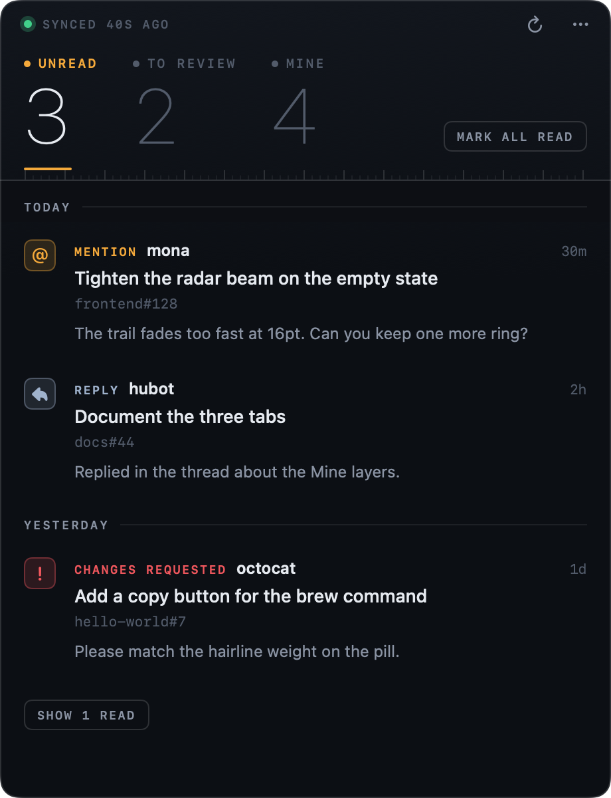
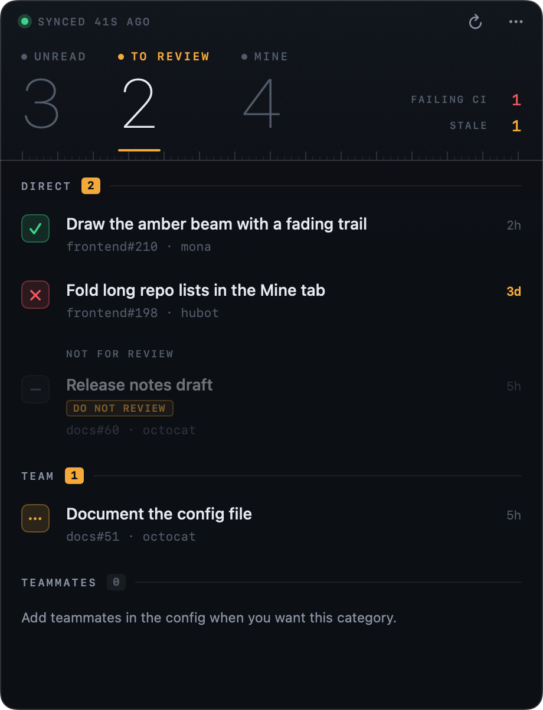
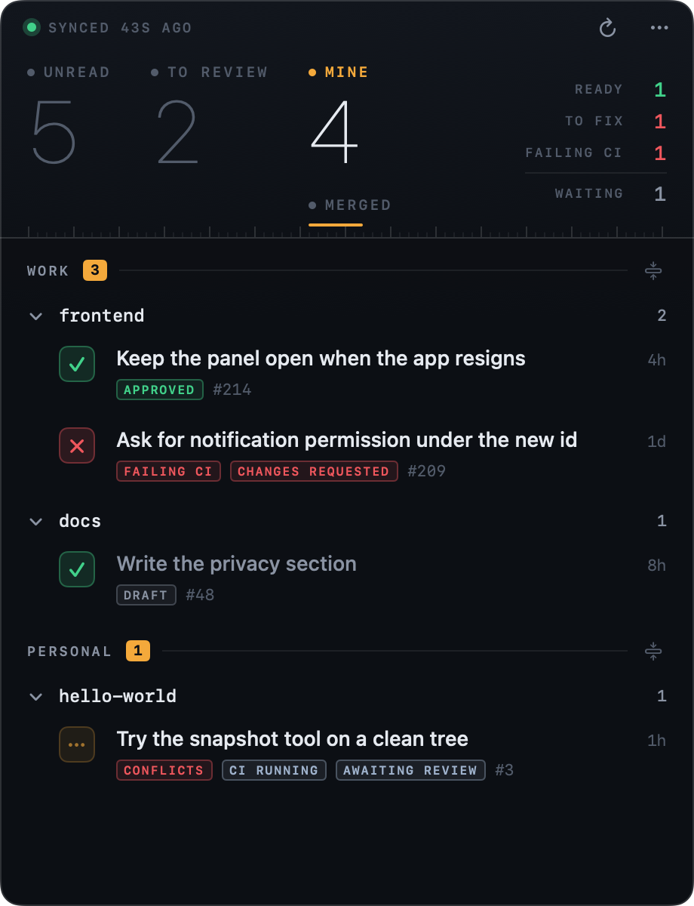

# Beacon

[](https://github.com/Avivhdr/beacon/actions/workflows/ci.yml)

Beacon is a macOS menu bar app for GitHub. It shows three things:

- Unread activity that needs you.
- Pull requests waiting for your review.
- Your own open pull requests.

The menu bar shows two counts, unread and reviews. Your own pull requests stay in the panel, on the Mine tab. Inside a group, pull requests sit under their repository. Click a repository to fold it. It stays folded until you click it again. The small icon at the end of a group's header folds every repository in that group, or unfolds them all once they're all folded.

With nothing unread and nothing to review, the icon is the GitHub mark.



The other two tabs:





## Install

Beacon needs macOS 14 or later.

**Disk image.** Download `Beacon.dmg` from the [latest release](https://github.com/Avivhdr/beacon/releases/latest). Open it, and drag Beacon to Applications.

**Homebrew.**

```sh
brew install --cask avivhdr/tap/beacon
```

The first public release is 1.0.0. Until that release is published, build from source below.

## Requirements

Install the [GitHub CLI](https://cli.github.com/) and sign in:

```sh
gh auth login
```

Beacon reads the token with `gh auth token`. If `GITHUB_TOKEN` is set, Beacon uses that value instead. If `gh` is missing, or GitHub rejects the token, the panel shows the sign-in steps and a Try again button.

If an organization uses SAML single sign-on, authorize the `gh` token for that organization. Beacon can only see the organizations the token is allowed to see. In GitHub: Settings, Developer settings, Personal access tokens, then authorize the token for each SSO organization. For `gh`, run `gh auth refresh -s read:org` and follow the SSO prompts.

## Privacy

The token stays on your Mac. Beacon sends it only to `api.github.com`. There is no analytics, and there is no other server.

The website is <https://beacon-for-github.vercel.app>.

## Updates

Beacon looks for a new version once a day. "Check for Updates…" in the ⋯ menu checks now. That menu also has Open at Login, About Beacon, and Report a Bug. Report a Bug opens a GitHub issue with the Beacon version, the macOS version, and the CPU architecture filled in.

The update feed is <https://beacon-for-github.vercel.app/appcast.xml>. The public update key is `GaHhzbvJpIsMlj66m8Ov0ZBep1fBFZsjRp8fM1rXHKI=`. Both are compiled into the app. They stay. A new feed address, or a new key, would leave every installed copy unable to update.

## What lands in the notifications feed

Beacon polls `/notifications?participating=true` for pull requests with new activity, then loads each changed pull request with GraphQL.

| Event | Shown |
|---|---|
| Comment on your pull request, on the conversation tab or inline | yes |
| Changes requested on your pull request | yes |
| Approval with a body | yes, unless `notifyApprovalsWithComments` is false |
| Bare approval | no |
| Reply in an inline thread you commented in | yes |
| New comment on someone else's pull request after you commented there | yes |
| `@you` or `@org/team` mention (a quoted mention does not count) | yes |
| Review requests | no, they are in the review count |
| Bots, `ignoredUsers`, your own activity | no |

Items on the same pull request sit together under its title, and each day lists the pull requests with activity that day, newest first. A pull request with activity across several days shows up under the day of its newest item. Click a pull request's title to fold it. Folded, it keeps one dot per item and its unread count, and it stays folded until you click it again. Hover the title for buttons that copy its link, open the pull request, or mark all of its items read.

Opening an item marks it read. The check button on hover marks it read without opening it. The link button next to it copies the link to that comment or review. Pull requests in the Reviews and Mine tabs have the same link button on hover, and every row has "Copy Link" in its right-click menu. When a pull request has no unread items left, Beacon marks that GitHub notification thread read too. Anything you read on github.com is marked read here.

## Config

Beacon writes `~/.config/beacon/config.json` on first launch, with defaults. "Open config file" in the panel's ⋯ menu opens it. Beacon reads the file again on every poll.

A config left at `~/.config/github-notifications/config.json` is copied across once. The old file stays.

You do not have to edit the file by hand for review filters. In the Reviews tab, right-click a pull request (or use the eye icon on hover) to hide that pull request, or to hide its repository from that category or from all of them. Hiding one pull request does not change the config. It stays on this Mac, leaves the counts and the menu bar badge, and comes back on its own once GitHub stops listing it. The "N hidden" button on a category brings those pull requests back. "Review filters…" in the ⋯ menu opens a window to add, rename, reorder, and delete categories, with repository chips and a live match count.

- `categories` is a list of `{ name, query, includeRepos, excludeRepos }`. A query is any GitHub search string. `{teammates}` expands to `author:` for every teammate. `includeRepos` limits the category to those repositories. The defaults are Direct, Team, and Teammates.
- `excludeRepos` at the top level hides repositories from every category.
- `skipLabels` (default `["DO NOT REVIEW"]`, any case): pull requests with one of these labels stay in the list, at the bottom, dimmed, with the label shown. They do not count toward any number.
- `teammates` lists logins. `teammatesTeam` (`org/slug`) adds that team's members. The Teammates category waits until you set one of these. Nothing else breaks.
- `badgeChain` decides the review count in the menu bar. The first category with open pull requests wins. `"dim": true` greys that count out.
- `myPRGroups` splits the Mine tab into layers, as a list of `{ name, repos }`. A repository entry is `org/repo`, or a bare `org` for every repository that organization owns. Each pull request goes to the first group that lists its repository. A group with an empty `repos` list takes everything the earlier groups did not. The default is one layer named Open. Example: `[{ "name": "Work", "repos": ["octo-org"] }, { "name": "Private", "repos": [] }]`.
- `mentionTeams` limits which `@org/team` mentions count. Leave it out to count every team you are in.
- `ignoredUsers`, `ignoreBots` (default true), `pollIntervalSeconds` (default 60), `lookbackDays` (default 3), `staleHours` (default 24), `systemNotifications` (default true), `notifyApprovalsWithComments` (default true).

State (feed items and read flags) lives in `~/Library/Application Support/Beacon/state.json`. Delete it to start over. A state file left under `GitHubNotifications` is copied across once. The old file stays.

## Build from source

You need Xcode and XcodeGen (`brew install xcodegen`), plus `gh auth login` as above.

```sh
make test                         # Core tests
make run                          # Debug build, then launch
make snapshots                    # panel PNGs in snapshots/, Debug only
./install.sh                      # Release build, copy to /Applications, launch
# one refresh, printed to the terminal, nothing saved:
build/Build/Products/Debug/Beacon.app/Contents/MacOS/Beacon --dump
./scripts/replay.sh 24            # forget the last 24h and relaunch, to see banners again
```

`project.yml` is the Xcode project source. The generated project is not in git.

See [CONTRIBUTING.md](CONTRIBUTING.md) for design rules and pull requests, and [DESIGN.md](DESIGN.md) for the visual system.
